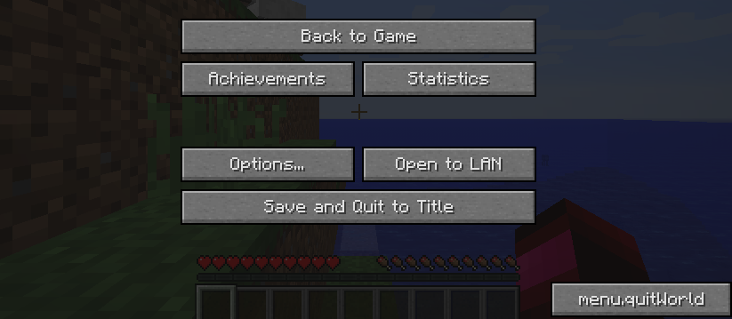

# Anchiale

Adds a faster way to exit worlds in 1.8. Use the Quit to Title button to exit the current world without waiting for the server tasks queue to complete. 

Any runs that save and quit using this button and then relog may not be considered verifiable, so only use this for exiting a world you don't intend to play again.

## Compatibility

Compatible with all other legal 1.8/1.8.9 mods. If using with Atum 1.8-1.8.9, the global reset hotkey will by default use the faster Anchiale reset, so don't use it for relogging.
